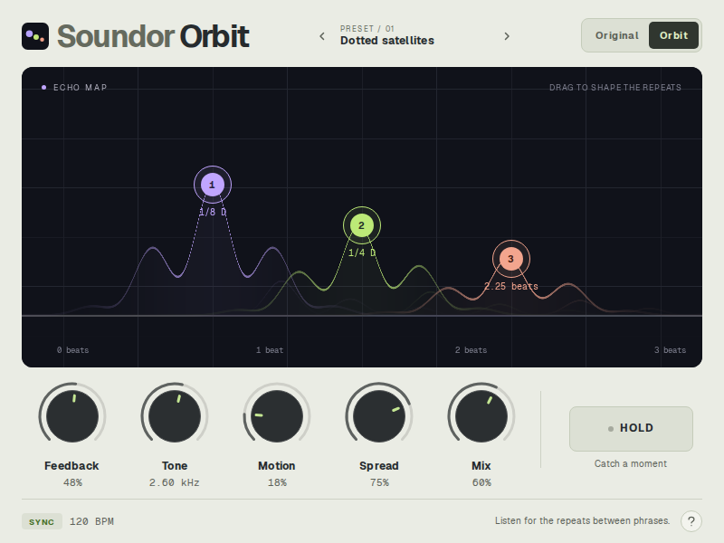

<p align="center">
  <picture>
    <source media="(prefers-color-scheme: dark)" srcset="assets/brand/soundor-orbit-logo-on-dark.svg">
    
  </picture>
</p>

# Soundor Orbit

A playable three-voice stereo delay, built with
[Soundor](https://soundor.dev). One React interface runs in a VST3 plugin and
in a browser. Try it at [orbit.soundor.dev](https://orbit.soundor.dev), or
download the VST3 for Linux or Windows from
[the releases](https://github.com/soundor/orbit/releases). A WebGL 2 echo map visualizes the
parameters; the handles and controls remain usable with a Canvas 2D fallback.



## Install

Download the zip for your platform from
[the latest release](https://github.com/soundor/orbit/releases/latest) and
unzip `Soundor Orbit.vst3` into your VST3 folder: `~/.vst3` on Linux,
`C:\Program Files\Common Files\VST3` on Windows. Then rescan plugins in your
DAW. `SHA256SUMS` in the release lists each zip's checksum, and
`gh attestation verify <zip> --repo soundor/orbit` checks that this
repository's release workflow built it. macOS builds are not released yet.

## Use it

Press the host's Play button to hear a short, bright pluck phrase followed by
silence. Listen for Orbit's answer in those gaps. The **Original / Orbit**
buttons compare the dry input with the current effect without changing its settings.
Choose a different source under **Host settings → Audio → Input**: the demo
phrase, an audio file, a microphone, an oscillator, or no input. The demo is a
registered custom host input; the plugin needs no extra toolbar. The VST3
version always processes the host's audio input.

- Drag an echo horizontally for time, vertically for level. Tab to an echo
  and use left/right for time, up/down for level. Sync snaps edits to 1/32
  notes at the host's tempo; Free uses 500 ms per displayed beat unit.
- Drag knobs vertically, scroll, or use arrows (Shift for larger steps).
  Home restores a knob's default.
- Hold captures each delay line without copying or allocating. Its loop
  remains until released, with a short seam crossfade; time changes alter
  playback speed. The dry input continues, and new input does not enter the
  captured loops. Feedback is ignored while held. Tone, width and mix still work.
- **Original** smoothly bypasses Orbit; **Orbit** restores the effect. The delay
  continues running while bypassed.
- Preset arrows apply four starting points and release Hold. The preset name
  identifies the starting point; parameter edits do not rename it.

`apps/plugin/src/` is portable Soundor UI: no DOM, browser audio, or platform checks.
The VST3 and Web runtimes run the same Rust processor from `apps/plugin/lib/`,
natively and in an AudioWorklet respectively. It uses three
filtered, saturated feedback lines, interpolated reads, smoothed delay times
and mix/bypass. The wet signal uses the input's mono sum; the dry signal
preserves stereo. The echo map depicts parameters, not a measured waveform.

WebGL resources are released on unmount. If WebGL is absent or shader setup
fails, a new canvas draws the echo map in 2D. No external assets or libraries
are needed for the graphics or demo audio. Hold is a creative loop, not a
transparent recorder; changing time changes pitch. There is no latency
compensation or oversampling.

## Develop

The repository is a pnpm workspace run by Turborepo: `apps/plugin` is the
plugin (package `orbit`), `apps/website` the site (Fumadocs on TanStack
Start: the landing page, the docs, the changelog from
`apps/plugin/CHANGELOG.md`, and the live player). You need Node 24, pnpm
(through corepack) and stable Rust; the VST3 build also needs
[Soundor's native prerequisites](https://soundor.dev/docs/vst3-runtime#requirements).

```sh
pnpm install
pnpm dev:web        # in the browser
pnpm dev            # the VST3 in Soundor's VST3 host
pnpm check          # format, lint, types, UI tests, Rust tests, the site: what CI runs
pnpm test:e2e       # the web build in Chromium (Playwright)
pnpm test:vst3      # the Debug VST3 in the VST3 host (xvfb-run -a without a display)
pnpm build:vst3     # apps/plugin/.soundor/dist/vst3/Soundor Orbit.vst3
pnpm website        # orbit.soundor.dev, with the live player
```

End-to-end tests run the built plugin: `apps/plugin/e2e/web/` the web build in Chromium, with
[Playwright](https://playwright.dev), and `apps/plugin/e2e/vst3/` the Debug VST3 in the real VST3
host, UI and audio together, with [`@soundor/vitest-e2e`](https://soundor.dev/docs/testing/e2e).
The first Playwright run needs its Chromium: `pnpm --filter orbit exec playwright install chromium`.

## Versions and releases

Versions follow semver, judged by what users have saved:

- **major**: a session or preset made with an earlier version no longer loads
  as it did: a parameter removed, renamed or remapped, or state changed
  without a migration. Before 1.0 these are minor releases.
- **minor**: new parameters, presets or features.
- **patch**: fixes, and Soundor upgrades that change nothing users see.

The plugin's ID, `dev.soundor.orbit`, never changes: hosts know the plugin by
the class IDs derived from it.

Commits follow [Conventional Commits](https://www.conventionalcommits.org).
[release-please](https://github.com/googleapis/release-please) keeps a release
pull request open with the next version in `apps/plugin/package.json`
(which `soundor.config.ts` reports to hosts) and `apps/plugin/CHANGELOG.md`,
from the commits that touch `apps/plugin`. Merging it tags the
release and runs `.github/workflows/release.yml`: the checks, the VST3 built
on Linux and Windows, the zips, `SHA256SUMS` and their provenance uploaded to
the draft release, which is then published, and the website deployed. A run
that stopped before publishing finishes from Actions → Release → Run workflow,
with the draft's tag.

## License & Branding

Orbit's software is licensed under the
[GNU Affero General Public License v3](LICENSE), Copyright (c) 2026-present
Dmitrii Balakin. Releases up to 0.1.1 were published under the MIT License,
and those copies stay under it.

The Soundor name and the Soundor Orbit logo are the project's identity, not
part of the software license: the logo files in [`assets/brand`](assets/brand)
have their own [notice](assets/brand/LICENSE.md). You are free to study, change
and redistribute Orbit's code under the AGPL, and to build plugins of your
own with Soundor; please give a fork its own name and logo rather than
presenting it as an official Soundor release. See the
[Brand Guidelines](https://soundor.dev/brand) and [BRANDING.md](BRANDING.md),
and the [Privacy Policy](https://soundor.dev/privacy).
